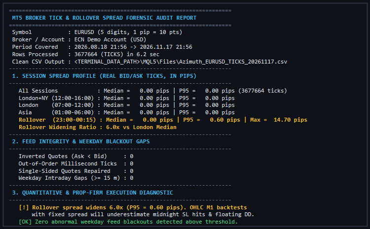

# MT5 Quant Tools — Broker Tick Forensic Auditor, Parquet Converter & Setfile Linter

[](./LICENSE)
[](https://www.mql5.com/en/code/79721)
[](./python/mt5_csv_to_parquet.py)
[](https://azimuthstudio.app/?utm_source=github_mt5_tools)

Open-source, **100% read-only diagnostic utilities** for **MetaTrader 5** algorithmic traders and Prop-Firm challengers.

Before running thousands of optimization passes on synthetic M1 OHLC bars—or deploying a `.set` file blind to midnight rollover spread widening—use these lightweight utilities to audit your broker's real Bid/Ask tick feed, convert multi-million-row CSVs into compact **Polars `.parquet`**, and catch silent `.set` file traps.


*Example output on 3,677,664 real EURUSD ticks audited in 6.2 seconds: `0.00 pips` London median spread vs **`14.70 pips` max rollover spike (`6.0x` P95 widening)** between `23:00` and `00:15` server time.*

---

## Included Utilities

### 1. `mql5/Azimuth_Tick_Audit_Exporter.mq5` (Native MQL5 Script)
Also available directly inside MetaTrader 5 via **[MQL5 CodeBase #79721](https://www.mql5.com/en/code/79721)**.
- **RAM-Safe 15-Day Chunk Streaming**: extracts up to 120 months of real broker Bid/Ask ticks via `CopyTicksRange` without freezing MetaTrader 5 memory.
- **Session Spread Percentiles (`P50` Median & `P95` in Pips)**: compares London+NY Overlap (`12:00–16:00`), London (`07:00–12:00`), Asia (`01:00–06:00`), and the **Rollover Window (`23:00–00:15`)** widening ratio.
- **Weekday Intraday Feed Blackout Detector**: counts unexpected weekday quote gaps (`>= 15 min`, automatically ignoring weekend market closures and Dec 25 / Jan 1 bank holidays) and prints the Top 3 longest blackouts.
- **Clean Millisecond CSV Export**: saves `TickAudit_<SYMBOL>_<DATE>.txt` and `Azimuth_<SYMBOL>_TICKS_<DATE>.csv` inside `MQL5\Files\` with a `#AZIMUTH_META` comment header.

**Quick Start in MetaTrader 5:**
1. Copy [`mql5/Azimuth_Tick_Audit_Exporter.mq5`](./mql5/Azimuth_Tick_Audit_Exporter.mq5) into your terminal's `MQL5/Scripts/` folder (`File -> Open Data Folder`) and press **F7** in MetaEditor.
2. Drag `Azimuth_Tick_Audit_Exporter` onto any symbol chart (`EURUSD`, `XAUUSD`, `US500`, `GBPJPY`, etc.).

---

### 2. `python/mt5_csv_to_parquet.py` (Polars Tick CSV → Zstd Parquet)
Converts both `Azimuth_Tick_Audit_Exporter` CSVs and native MetaTrader 5 `Symbols -> Ticks -> Export` (`UTF-16 LE` / `UTF-8`) files into compressed **Zstandard `.parquet`** (`4x–6x` smaller on disk) while printing a rollover spread audit.

```bash
pip install polars
python python/mt5_csv_to_parquet.py Azimuth_EURUSD_TICKS_20261117.csv
```

---

### 3. `python/mt5_setfile_inspector.py` (MT5 `.set` Linter, Diff & UTF-16 LE Sanitizer)
MetaTrader 5 silently ignores malformed `.set` lines (such as INI `[Group]` headers or misspelled keys), causing Expert Advisors to trade with unintended compiled defaults.

```bash
# Audit a single .set file (UTF-16 LE BOM or UTF-8) for silent pitfalls & risk flags:
python python/mt5_setfile_inspector.py strategy_v1.set

# Compare two .set versions side-by-side:
python python/mt5_setfile_inspector.py strategy_v1.set strategy_v2.set

# Strip Strategy Tester '||start||step||stop' ranges and export strict UTF-16 LE BOM:
python python/mt5_setfile_inspector.py messy.set --clean-out clean_mt5.set
```

---

## Next Step: Stress-Test on 28M Ticks in ~0.6s/Combination

Once your broker `.csv` or `.parquet` tick file is ready, **[Azimuth Studio](https://azimuthstudio.app/?utm_source=github_mt5_tools)** lets you run institutional-grade quantitative verification in your browser—built natively for MetaTrader 5:

- **100% Compiled CPU Engine (Numba + Polars)**: evaluates a full tick-by-tick parameter combination over **28 million real ticks in ~0.6 seconds** in exact account currency (`USD`, `EUR`, `JPY`, etc.).
- **Bayesian TPE Optimization (Optuna) + K-Fold Walk-Forward**: maps stable Out-of-Sample parameter plateaus instead of brittle genetic needles.
- **Automated 6-Month Sub-Period & 2x/3x Slippage Confirmation**: replays saved candidates across half-year slices and doubled slippage, plus up to **10,000 Monte Carlo scenarios** and server-midnight Prop-Firm floating drawdown tracking.
- **1-Click `.set` Export & Multi-EA `RoboFolio`**: deploy individual setups or balanced multi-strategy portfolios directly into MetaTrader 5.

### Free Quantitative Engineering Guides for MT5
- [Exporting Real MetaTrader 5 Ticks to Parquet Without Data Gaps](https://azimuthstudio.app/en/guides/mt5-tick-export-parquet?utm_source=github_mt5_tools)
- [Why 99% Modelling Quality MT5 Backtests Fail Live: Rollover Spreads & Slippage](https://azimuthstudio.app/en/guides/why-mt5-99-backtest-loses-live-rollover-spread?utm_source=github_mt5_tools)
- [Bayesian TPE Optimization (Optuna) vs MT5 Genetic Algorithm](https://azimuthstudio.app/en/guides/mt5-strategy-tester-genetic-vs-bayesian-tpe?utm_source=github_mt5_tools)
- [2026 Prop-Firm Unique Strategy & Midnight Floating Drawdown Rules on MT5](https://azimuthstudio.app/en/guides/prop-firm-unique-strategy-rule-2026-mt5?utm_source=github_mt5_tools)
- [Eliminating Multi-Timeframe (MTF) Look-Ahead Bias in MT5 Backtests](https://azimuthstudio.app/en/guides/multi-timeframe-lookahead-bias-mt5-backtest?utm_source=github_mt5_tools)
- [Browse all 16 MT5 Quantitative Engineering Guides (EN / FR / DE / ES / JA)](https://azimuthstudio.app/en/guides?utm_source=github_mt5_tools)

---

## Disclaimer & License
Released under the [MIT License](./LICENSE). These utilities are software tools for historical market data diagnostics and file preparation; nothing in this repository constitutes investment advice, and past backtest metrics do not guarantee future live trading results.
